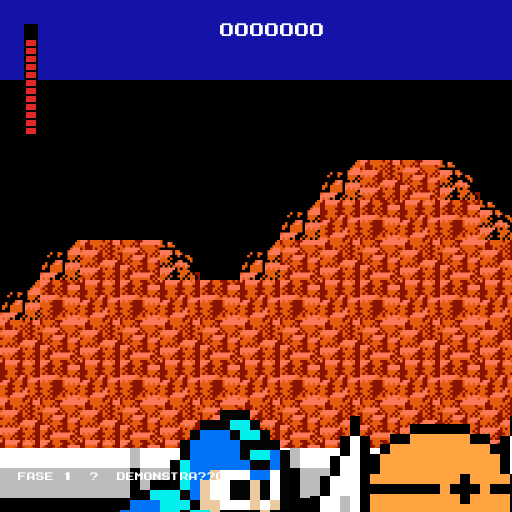

# 2D Megman

Um jogo de plataforma 2D inspirado nos clássicos de ação, desenvolvido com
Python e Pygame.



## Como jogar

### Windows

Com Python instalado, clique duas vezes em [`run_game.bat`](run_game.bat) para
abrir o jogo. Pelo GitHub, o link não pode executar arquivos diretamente por
motivos de segurança; nesse caso, baixe o repositório e abra o arquivo
`run_game.bat` localmente.

### Execução pelo terminal

```powershell
python -m pip install -r requirements.txt
python GameWindow.py
```

Se o ambiente virtual do projeto já estiver configurado:

```powershell
.venv\Scripts\python.exe GameWindow.py
```

## Controles

| Tecla | Ação |
| --- | --- |
| `A` / `←` | Mover para a esquerda |
| `D` / `→` | Mover para a direita |
| `W` / `↑` | Pular |
| `X` / `Espaço` | Atirar |
| `ESC` | Pausar e continuar |
| `Enter` | Reiniciar após Game Over |

## Recursos

- Três fases com seleção de dificuldade.
- Inimigos, projéteis, obstáculos e itens coletáveis.
- Sistema de pontuação e Game Over.
- Pausa com `ESC`.
- Progresso salvo em `progress.json`, mesmo depois de fechar o jogo.
- Fases concluídas identificadas no menu.

## Estrutura principal

```text
.
├── GameWindow.py          # Loop principal e regras do jogo
├── tile_map.py            # Mapas das fases
├── images/                # Sprites, cenário e telas
├── megaman-game-font.otf  # Fonte usada na interface
├── progress.json          # Progresso salvo localmente
└── run_game.bat           # Atalho para iniciar no Windows
```

## Tecnologias

- Python 3.12+
- Pygame
- Pillow (usado para gerar a imagem de demonstração)
